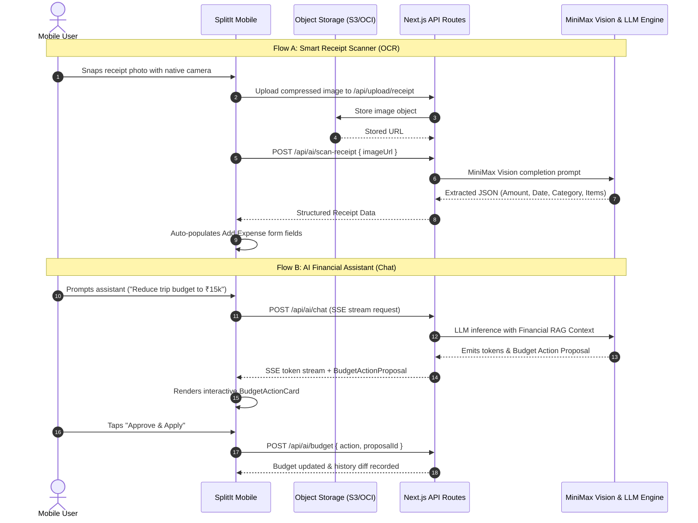

# SplitIt Mobile (iOS & Android) — Master Architecture & Implementation Plan

> **Scope**: Complete, production-grade native iOS and Android application for public release on the Apple App Store and Google Play Store. Contains all user-facing functionalities (Dashboard, Groups, Expenses, Settlements with UPI deep-linking and QR, Budgets, Granular Activity History, Notifications, Customer Support, and Deep AI Capabilities) while **strictly excluding the administrative control panel**.

---

## 1. Executive Summary, Vision & Core Tenets

SplitIt Mobile is engineered to be a **sleek, minimal, ultra-responsive financial companion** for shared expense tracking, peer-to-peer settlements, and AI-assisted financial management.

```
┌────────────────────────────────────────────────────────────────────────────────────────┐
│                                 SPLITIT MOBILE VISION                                  │
├────────────────────────────────────────────────────────────────────────────────────────┤
│  📱 Sleek & Minimal      │ Dark-mode-first, crisp borders, high typography contrast    │
│  ⚡ Fluid 60/120 FPS      │ Reanimated 3 UI worklets, spring dampening, tactile haptics │
│  📊 Minimalist Metrics   │ 3 glanceable micro-visualizations (no heavy desktop charts) │
│  ✦ Deep AI Everywhere    │ Streaming SSE assistant, Camera receipt OCR, auto-balancing │
│  🌐 100% Backend Reused  │ Reuses existing 56 REST endpoints, Oracle NoSQL, AI RAG     │
└────────────────────────────────────────────────────────────────────────────────────────┘
```

### 1.1 Core Tenets
1. **Sleek, Minimal & Modern Aesthetics**: High-contrast, dark-mode-first geometric design system, clean typography, compact cards, subtle borders (`border-white/10`), zero visual clutter.
2. **Smooth, Fluid Motion (60–120 FPS)**: Native physics-based spring animations for modals/drawers, fluid shared-element screen transitions, tactile gesture-driven interactions (swipe to settle, swipe to delete), and haptic micro-feedback.
3. **Less Detailed Graphs Only**: Replaces desktop-oriented, multi-axis chart dashboards with lightweight, minimalist visual summaries: 6-bar monthly velocity micro-charts, sleek category donut rings, and circular budget pacing indicators.
4. **Deep AI Integration**: Native camera receipt scanning with MiniMax Vision OCR auto-fill, real-time category suggestion, conversational AI assistant with streaming responses, and 1-tap in-chat budget auto-balancing proposals.
5. **Zero Backend Rewrite**: Reuses 100% of the existing Oracle NoSQL database schema, business logic services, AI pipelines, and Next.js REST API routes. All backend adaptations are purely additive.

---

## 2. Full Codebase Scan & 100% Reusability Blueprint

A complete audit of the SplitWise-Clone repository (`v0.4.1`, branch `dev`) identifies **~36,500 total lines of code** across 240+ files.

```
Total Repository Breakdown (by lines of code):
┌─────────────────────────────────────────────────────────────┐
│ Client UI Components          18,684 lines  [51%] (Native)  │
│ Admin Panel (Pages & UI)       6,046 lines  [17%] (Excluded)│
│ Web App Pages                  3,825 lines  [10%] (Native)  │
│ Backend API Routes             3,433 lines  [9%]  (Reused)  │
│ Lib Services & Domain Logic    2,155 lines  [6%]  (Reused)  │
│ Lib AI & RAG Engine            2,043 lines  [5%]  (Reused)  │
│ Hooks & Contexts               1,279 lines  [4%]  (Adapted) │
│ Core Math & Shared Types         950 lines  [3%]  (Shared)  │
└─────────────────────────────────────────────────────────────┘
```

### 2.1 Reusability Classification Matrix

| Code Segment | Lines | Files | Reusability Verdict | Technical Strategy |
| :--- | :---: | :---: | :---: | :--- |
| **Backend REST APIs** (`src/app/api/`) | 3,433 | 56 | **100% Reused** | Mobile calls existing Next.js API endpoints over HTTPS with bearer auth. |
| **Backend Services** (`src/lib/services/`) | 2,155 | 11 | **100% Reused** | Runs unmodified on server (groups, users, notifications, expenses, settlements). |
| **AI Backend & Vector RAG** (`src/lib/ai/`) | 2,043 | 10 | **100% Reused** | MiniMax LLM, vision OCR, RAG context builder, guardrails run on server. |
| **Domain Logic & Math** (`packages/core/`) | 950 | 8 | **100% Shared** | Pure TS: split calculations, greedy debt simplification, budget math, diffs. |
| **Universal Types** (`src/types/`) | 620 | 3 | **100% Shared** | All TypeScript interfaces and Zod schemas shared directly across monorepo. |
| **Data Fetchers & Query Keys** (`hooks/queries/`) | 219 | 4 | **90% Shared** | TanStack Query query keys and fetcher functions ported directly to mobile. |
| **App State & Auth** (`src/contexts/`) | 543 | 4 | **75% Adapted** | Converted to React Native using SecureStore, Zustand, and MMKV. |
| **Client UI Components** (`src/components/`) | 18,684 | 99 | **Native Rewrite** | Radix UI / HTML primitives replaced with React Native primitives + NativeWind. |
| **Web Pages** (`src/app/(app)/`) | 3,825 | 16 | **Native Rewrite** | Replaced with file-based native routing via Expo Router v4. |
| **Admin Panel** (`(admin)/`, `components/admin/`) | 6,046 | 25 | **Excluded** | Excluded per specifications. |

### 2.2 Shared Domain Package (`packages/core/`)
The platform-agnostic business logic has been extracted into `@splitit/core`:
- [`packages/core/src/split.ts`](file:///d:/Projects/SplitWise-Clone/packages/core/src/split.ts): Split calculations (`calculateSplitAmounts`), rounding reconciliation (`reconcileToTotal`), and validation (`validateSplit`) for Equal, Unequal, Shares, and Percentage modes.
- [`packages/core/src/debts.ts`](file:///d:/Projects/SplitWise-Clone/packages/core/src/debts.ts): Greedy multi-party debt simplification algorithm (`simplifyDebts`).
- [`packages/core/src/categories.ts`](file:///d:/Projects/SplitWise-Clone/packages/core/src/categories.ts): Master and sub-category taxonomy, keyword matching (`classifyExpense`).
- [`packages/core/src/diffs.ts`](file:///d:/Projects/SplitWise-Clone/packages/core/src/diffs.ts): Granular audit diff generator (`diffBudgetChanges`) for tracking budget modifications.
- [`packages/core/src/budget.ts`](file:///d:/Projects/SplitWise-Clone/packages/core/src/budget.ts): Budget burn pacing (`computeBudgetBreakdown`), auto-balancing (`calculateSmartCategoryReduction`), and delta validation.
- [`packages/core/src/names.ts`](file:///d:/Projects/SplitWise-Clone/packages/core/src/names.ts): Name formatting and initials extraction (`getFullName`, `getInitials`).
- [`packages/core/src/constants.ts`](file:///d:/Projects/SplitWise-Clone/packages/core/src/constants.ts): Standard currency definitions and symbols.

---

## 3. Technology Stack, Monorepo Architecture & Dependencies

### 3.1 Monorepo Directory Architecture
```
SplitWise-Clone Monorepo Architecture:
d:/Projects/SplitWise-Clone/
├── src/                          # Next.js 15 Web Application & Serverless REST API
│   ├── app/api/                  # 56 authenticated REST routes
│   ├── lib/                      # Server-side services, Oracle NoSQL adapter, MiniMax AI
│   └── components/               # Web Radix UI / Tailwind components
├── packages/core/                # Platform-Agnostic Shared TypeScript Package
│   ├── src/
│   │   ├── split.ts              # Universal expense splitting math
│   │   ├── debts.ts              # Greedy debt simplification algorithm
│   │   ├── budget.ts             # Budget pacing & shortfall auto-balancing
│   │   ├── categories.ts         # Master/Sub-category ontology
│   │   ├── diffs.ts              # Audit log diff generator
│   │   ├── names.ts              # User naming utilities
│   │   └── constants.ts          # Currencies & formatting constants
│   ├── package.json              # @splitit/core
│   └── tsconfig.json             # Isolated strict TS configuration
└── mobile/                       # React Native Mobile Application (Expo SDK 52)
    ├── app/                      # Expo Router v4 file-based screens
    │   ├── (auth)/               # Login, Signup, Forgot/Reset Password
    │   ├── (tabs)/               # Home, Groups, Center (+), Activity, Profile
    │   ├── groups/[id]/          # Group Detail Stack (Expenses, Balances, Budget, Activity, Settings)
    │   ├── expenses/             # Add & Edit Expense modals
    │   ├── settle/               # Settle Up & High-Contrast UPI QR modal
    │   ├── ai/                   # Streaming Assistant & Camera Receipt OCR
    │   ├── notifications/        # Notification Center & Preferences
    │   └── support/              # In-App Support Tickets & Live Threads
    ├── components/               # Native UI (NativeWind v4 + Reanimated 3)
    ├── hooks/                    # TanStack Query & native hardware hooks
    └── lib/                      # SecureStore, Expo Notifications, Haptics, Audio
```

### 3.2 Mobile Dependency Matrix

| Category | Recommended Package | Version | Purpose |
| :--- | :--- | :--- | :--- |
| **Runtime & Framework** | `expo` | `~52.0.0` | Managed native runtime with OTA support |
| **File-Based Routing** | `expo-router` | `~4.0.0` | Deep linking, typed routes, native tabs |
| **Styling & Design Tokens** | `nativewind` | `^4.1.0` | Tailwind CSS v3 tokens mapped from web |
| **Motion & Physics** | `react-native-reanimated` | `~3.16.0` | 60/120 FPS UI-thread animations, worklets |
| **Gesture System** | `react-native-gesture-handler`| `~2.20.0` | Pan gestures, swipe-to-action, edge swipes |
| **Action Drawers** | `@gorhom/bottom-sheet` | `^5.0.0` | Spring-physics sheets with snap points |
| **State & Cache** | `@tanstack/react-query` | `^5.60.0` | Server-state caching, optimistic updates |
| **Offline Storage** | `react-native-mmkv` | `^3.1.0` | Ultra-fast synchronous key-value persister |
| **Secure Keyring** | `expo-secure-store` | `~14.0.0` | iOS Keychain & Android Keystore auth storage |
| **Form Management** | `react-hook-form`, `zod` | `^7.53.0` | Form handling with identical web Zod schemas |
| **Typography & Icons** | `lucide-react-native` | `^0.460.0` | Complete icon parity with desktop web UI |
| **Minimalist Micro-Charts**| `victory-native` (XL / Skia) | `^41.0.0` | Hardware-accelerated sparklines & rings |
| **Push Notifications** | `expo-notifications`, `expo-device` | `~0.9.0` | Native APNs & FCM push token management |
| **Camera & Receipt OCR** | `expo-camera`, `expo-image-manipulator` | `~16.0.0` | Camera capture, aspect crop, compression |
| **Tactile Haptics** | `expo-haptics` | `~14.0.0` | Micro-vibrations for tabs, swiping, success |
| **Payments & Linking** | `expo-linking`, `react-native-qrcode-svg` | `~7.0.0` | UPI intent launching & high-contrast QR codes |

---

## 4. Sleek, Minimal & Modern Design System

SplitIt Mobile implements the **Dark-Mode Glass-Pane Minimalist System** defined in [`design-system.md`](file:///d:/Projects/SplitWise-Clone/design-system.md), optimized for high-density mobile displays.

```
Visual Architecture:
┌────────────────────────────────────────────────────────┐
│ Top Bar: Frosted Glass Header (BlurView, Title, Action)│
├────────────────────────────────────────────────────────┤
│ Hero Balance Card: Monochromatic with Emerald Accent   │
│ ┌────────────────────────────────────────────────────┐ │
│ │  Net Balance: +₹14,250.00 (Animated Counter)       │ │
│ │  [ You are owed ₹18,500 ]  [ You owe ₹4,250 ]      │ │
│ └────────────────────────────────────────────────────┘ │
├────────────────────────────────────────────────────────┤
│ Section: AI Predictive Insight Capsule                 │
│ ┌────────────────────────────────────────────────────┐ │
│ │  ✦ Velocity: +18% faster • Driven by Dining Out    │ │
│ └────────────────────────────────────────────────────┘ │
├────────────────────────────────────────────────────────┤
│ Recent Activity / Groups (High-Density List Rows)       │
│  [🍔 Dinner at Social]    Paid by You      +₹1,200.00  │
│  [⚡ Uber Trip]            You owe Rohit      -₹150.00  │
├────────────────────────────────────────────────────────┤
│ Floating Action Button: Quick Add [+] / AI Drawer [✦]  │
├────────────────────────────────────────────────────────┤
│ Bottom Tabs: [Home] [Groups]  ( + )  [Activity] [Me]   │
└────────────────────────────────────────────────────────┘
```

### 4.1 Design Tokens & Color Palette
- **Canvas / Background**: `#09090B` (Pitch Charcoal), cards in `#18181B` (Zinc-900), elevated surfaces in `#27272A` (Zinc-800).
- **Crisp Borders**: `border-white/10` (`rgba(255, 255, 255, 0.08)`), subtle separators in `border-white/5`.
- **Text Contrast**: Primary text in `#FAFAFA` (Zinc-50), secondary labels in `#A1A1AA` (Zinc-400), micro-captions in `#71717A` (Zinc-500).
- **Semantic Accents**:
  - Positive Balances / Owed to You: Emerald-500 (`#10B981`)
  - Negative Balances / You Owe: Rose-500 (`#F43F5E`)
  - AI Features / Proposals: Violet-500 (`#8B5CF6`)
  - Warnings / Budget Thresholds: Amber-500 (`#F59E0B`)
- **Typography Scale**:
  - Hero Numbers: `text-3xl font-black font-mono tracking-tight`
  - Screen Titles: `text-xl font-bold tracking-tight text-white`
  - Row Titles: `text-sm font-semibold text-zinc-100`
  - Micro-Badges: `text-[10px] font-bold uppercase tracking-wider`

### 4.2 Motion & Animation Physics
All animations are driven on the native thread using Reanimated 3 worklets:
```typescript
// Shared Spring Configurations
export const SPRING_CONFIGS = {
  // Snappy action sheets and modal presentations
  sheet: { damping: 20, stiffness: 200, mass: 0.8 },
  // Bouncy micro-interactions (FAB, badges, toggles)
  bouncy: { damping: 14, stiffness: 160, mass: 0.6 },
  // Smooth number transitions and list enters
  smooth: { damping: 24, stiffness: 120, mass: 1.0 },
};
```

- **Animated Number Counter**: Balances interpolate smoothly between values using Reanimated 3 text worklets on data change.
- **Swipe-to-Action**:
  - Swipe Right (threshold 80px): Green "Settle Up" action with `Haptics.impactAsync(Light)`.
  - Swipe Left (threshold 80px): Red "Delete" action with `Haptics.impactAsync(Medium)`.
- **Haptic Feedback Matrix**:
  - Tab Switch: `Haptics.selectionAsync()`
  - Keypad Tap: `Haptics.impactAsync(Light)`
  - Settle Recorded: `Haptics.notificationAsync(Success)`
  - Validation Error: `Haptics.notificationAsync(Error)`

---

## 5. "Less Detailed Graphs Only": Minimalist Micro-Metrics Architecture

The desktop application includes multi-axis timeline charts and dense tabular breakdowns. On portrait mobile devices, these become cluttered and unreadable. SplitIt Mobile replaces them with **three sleek, glanceable micro-visualizations**:

```
1. Velocity Micro-Bar (Monthly Trend)
   Monochrome 6-bar sparkline showing spend pacing relative to 6-month average.
   [ ▇ ▅ █ ▆ ▄ ▇ ]  "₹22.4k this month (8% below avg)"

2. Category Segmented Pill Bar
   Single horizontal segmented capsule with colored segments for top categories:
   [████████ Food 54% ][████ Travel 26% ][██ Other 20%]

3. Budget Pacing Ring
   Minimalist 120-degree arc gauge or slim circular ring:
   72% used • 8 days left • Safe Allowance: ₹420/day
```

### 5.1 The 3 Minimalist Mobile Visualizations

#### Micro-Visualization 1: Monthly Spend Velocity Sparkline (`<VelocitySparkline />`)
- **Visual Form**: 6 vertical pill bars (representing the last 6 months), rendered via Skia.
- **Height**: 48px compact card widget.
- **Interaction**: The current month is highlighted with emerald tint; past months in muted zinc. Tapping a bar displays a tooltip pill with that month's total spend.
- **Metric**: Displayed alongside single trend string: `"₹24,500 this month • 12% lower than 6mo avg"`.

#### Micro-Visualization 2: Category Segmented Capsule (`<CategoryCapsuleBar />`)
- **Visual Form**: Single horizontal capsule (`h-3.5 rounded-full overflow-hidden flex-row bg-zinc-800`).
- **Segments**: Proportional widths for top 3 categories + "Other" bucket.
  - Food & Drinks: Emerald-400 (`#34D399`)
  - Travel & Transport: Blue-400 (`#60A5FA`)
  - Shopping & Groceries: Purple-400 (`#A78BFA`)
  - Utilities & Others: Amber-400 (`#FBBF24`)
- **Interaction**: Tapping any segment highlights matching expenses in the list below.

#### Micro-Visualization 3: Circular Budget Pacing Ring (`<BudgetPacingRing />`)
- **Visual Form**: 240-degree open arc or slim 360-degree ring (`strokeWidth: 6`, diameter `80px`).
- **Dynamic Color**: Smooth gradient transition:
  - `< 75%` spent: Emerald-500 (`#10B981`)
  - `75% - 99%` spent: Amber-500 (`#F59E0B`)
  - `≥ 100%` spent: Rose-500 (`#F43F5E`)
- **Center Stat**: Displays `72%` in bold font. Subtitle beneath ring displays: `"₹420/day safe burn rate (8 days remaining)"`.

---

## 6. Comprehensive AI Capabilities Architecture

All AI features from the web app are supported natively via existing backend pipelines:



### 6.1 Conversational Financial Assistant
- **Floating AI Trigger**: Accessible via a sleek floating button on Home and Group pages or via long-press on the center (+) navigation button.
- **Streaming Responses**: Uses `expo/fetch` to read server-sent event (SSE) token chunks, streaming words naturally onto the screen.
- **Financial RAG Grounding**: Inherits the server-side `buildFinancialSnapshot` context builder, allowing the AI to answer questions about group balances, debts, and spending trends with 100% mathematical accuracy.
- **Interactive Action Cards (`BudgetActionCard`)**: If the user requests a budget change, the AI returns an interactive card directly in the chat with a breakdown of category adjustments and an "Approve & Apply" button.
- **Deep-Link Action Pills**: Chat suggestions include interactive navigation links (e.g. `[Open "Goa Trip" Balances]`) that navigate the user directly to the target screen.

### 6.2 Smart Receipt Scanner (OCR)
- **Native Camera & Cropper**: Uses `expo-camera` with a live edge-guide viewfinder and flashlight toggle. Users can also pick from their photo library.
- **Image Compression**: Automatically resizes and compresses captured images before upload to conserve mobile bandwidth.
- **Form Auto-Fill**: Parses total amount, purchase date, merchant name, description, master category, and itemized participant splits directly into the Add Expense bottom sheet.

### 6.3 Real-Time Category Suggestion
- **Debounced Text Classifier**: As the user types an expense description (e.g. "Flight to Mumbai"), the mobile app invokes `classifyExpense` from `packages/core` locally with 0ms network latency. If uncertain, it queries `/api/ai/suggest-category`.

### 6.4 Smart Category Auto-Balancing
- Client-side execution of `calculateSmartCategoryReduction` from `packages/core`. When a user lowers a group budget below current category allocations, the shortfall is proportionally distributed across categories in clean ₹100 steps with zero arithmetic drift.

---

## 7. Complete Screen-by-Screen Navigation Architecture

```
Expo Router v4 Directory Layout:
mobile/app/
├── _layout.tsx                     # Root provider (Theme, QueryClient, Auth, BottomSheet)
├── (auth)/
│   ├── _layout.tsx                 # Stack layout with smooth slide transitions
│   ├── login.tsx                   # Email/Password, Google OAuth, Sign in with Apple
│   ├── signup.tsx                  # 2-step registration (Account -> Profile Setup)
│   ├── forgot-password.tsx         # Password reset email request
│   └── reset-password.tsx          # Token validation and password reset form
├── (tabs)/
│   ├── _layout.tsx                 # Frosted blur tab bar with custom center (+) button
│   ├── index.tsx                   # Tab 1: Home Dashboard (Hero Balance, Micro-Charts)
│   ├── groups.tsx                  # Tab 2: Groups List (Active / Archived, Search)
│   ├── create.tsx                  # Tab 3: Center (+) interceptor (triggers Action Sheet)
│   ├── activity.tsx                # Tab 4: Granular Audit Activity Feed
│   └── profile.tsx                 # Tab 5: User Settings, UPI, Preferences & Support
├── groups/
│   ├── new.tsx                     # Create Group modal sheet
│   └── [id]/
│       ├── _layout.tsx             # Group Detail shell with segmented top tabs
│       ├── index.tsx               # Redirects to expenses tab
│       ├── expenses.tsx            # Group Expenses list (Filters, Pull-to-refresh)
│       ├── balances.tsx            # Simplified Debts ("Who pays whom") & Settle Up
│       ├── budget.tsx              # Budget Pacing Ring, Category Bars, Auto-balance
│       ├── activity.tsx            # Group Audit History with color-coded diffs
│       └── settings.tsx            # Edit Group, Invite Members, Archive/Delete
├── expenses/
│   ├── new.tsx                     # Add Expense bottom sheet (Hero keypad, 4 split modes)
│   └── [id].tsx                    # Expense Detail & Edit sheet with receipt zoom
├── settle/
│   ├── new.tsx                     # Settle Up modal (Payee, Amount, Payment Method)
│   └── qr.tsx                      # High-contrast UPI QR Code with 1-tap copy
├── ai/
│   ├── chat.tsx                    # Floating AI Financial Assistant modal with SSE stream
│   └── scanner.tsx                 # Native Camera Viewfinder for Receipt OCR
├── notifications/
│   ├── index.tsx                   # In-App Notification Center (Swipe-to-read)
│   └── preferences.tsx             # Granular push/email notification toggles
├── support/
│   ├── index.tsx                   # Support Tickets list
│   ├── new.tsx                     # Create Support Ticket form
│   └── [id].tsx                    # Live Ticket Messaging thread
└── legal/
    ├── privacy.tsx                 # In-App Privacy Policy viewer
    ├── terms.tsx                   # In-App Terms of Service viewer
    └── delete-account.tsx          # Self-Service Account Deletion modal
```

---

## 8. Component Reuse & Parity Matrix

| Web Component (`src/components/`) | Mobile Implementation (`mobile/components/`) | Reused Logic / Core | Styling & Primitives |
| :--- | :--- | :--- | :--- |
| `ExpenseForm` (`expense-form.tsx`) | `ExpenseFormSheet.tsx` | `@splitit/core/split` | Native numerical keypad, Reanimated slide |
| `SimplifyDebts` (`balance-summary.tsx`) | `DebtSummaryCard.tsx` | `@splitit/core/debts` | FlashList rows, Green settle button |
| `BudgetHistoryDiff` (`group-history.tsx`)| `BudgetDiffItem.tsx` | `@splitit/core/diffs` | Emerald/Rose diff tags, Bot icon |
| `SetBudgetDialog` (`set-budget-dialog.tsx`)| `SetBudgetSheet.tsx` | `@splitit/core/budget` | Slider + INR input, Auto-balance trigger |
| `ChatPanel` (`chat-panel.tsx`) | `AiChatModal.tsx` | SSE chunk parser | `expo/fetch` streaming, KeyboardAvoidingView |
| `BudgetActionCard` (`chat-panel.tsx`) | `BudgetProposalCard.tsx`| Proposal schema | Animated card with "Approve & Apply" button |
| `ReceiptUpload` (`receipt-upload.tsx`) | `CameraScannerView.tsx` | `/api/ai/scan-receipt`| `expo-camera`, auto-crop, compression |
| `UpiQrModal` (`upi-qr-modal.tsx`) | `UpiQrSheet.tsx` | UPI URL generator | `react-native-qrcode-svg`, high contrast |
| `CategoryPicker` (`category-picker.tsx`)| `CategoryPickerSheet.tsx`| `@splitit/core/categories`| Grouped grid with Lucide icons |

---

## 9. Data Layer, Offline Strategy & Optimistic Updates

SplitIt Mobile uses **TanStack Query v5 + MMKV** to ensure instant screen loads, offline resilience, and immediate UI updates:

```
┌─────────────────────────────────────────────────────────────┐
│                 DATA ARCHITECTURE LIFECYCLE                 │
├─────────────────────────────────────────────────────────────┤
│ 1. Launch -> Instant MMKV Cache Hydration (<5ms)            │
│ 2. Background Revalidation via TanStack Query               │
│ 3. User Mutates (e.g. Add Expense) -> Optimistic Local Item │
│ 4. Dispatch to /api/expenses via HTTPS                      │
│ 5. Success -> Sync Server ID | Offline -> Queue in MMKV     │
└─────────────────────────────────────────────────────────────┘
```

### 9.1 Cache TTLs & Invalidation Rules
- **User Profile & Session**: Cached indefinitely in `expo-secure-store`; refreshed on app resume.
- **Groups List**: 5 minutes stale time, 24 hours garbage collection time.
- **Group Detail & Expenses**: 2 minutes stale time. Invalidated immediately upon creating/editing an expense or recording a settlement.
- **Balances & Debts**: 1 minute stale time. Auto-recalculated locally using `@splitit/core` on optimistic expense creation.

---

## 10. Settlements, Simplified Debts & UPI Deep-Linking Matrix

### 10.1 UPI Deep-Linking Flow
When a user settles an Indian Rupee (`₹`) expense:
1. App formats the standard URI:
   ```
   upi://pay?pa={upiId}&pn={encodeURIComponent(name)}&am={amount.toFixed(2)}&cu=INR&tn={encodeURIComponent(notes)}
   ```
2. App invokes `Linking.openURL(uri)`.
3. The OS displays the native app chooser (Google Pay, PhonePe, Paytm, BHIM, CRED).
4. If no UPI app is installed or user cancels, app presents the **High-Contrast UPI QR Sheet** with 1-tap clipboard copy for `{upiId}`.

### 10.2 Native Query Schemes (`app.json`)
```json
{
  "expo": {
    "ios": {
      "infoPlist": {
        "LSApplicationQueriesSchemes": [
          "upi", "gpay", "phonepe", "paytmmp", "bhim", "credpay", "slice"
        ]
      }
    },
    "android": {
      "intentFilters": [
        {
          "action": "VIEW",
          "data": { "scheme": "splitit" }
        }
      ]
    }
  }
}
```

---

## 11. Push Notifications & Background Lifecycle

Mobile clients register for push notifications using Expo's notification pipeline:
1. Mobile calls `Notifications.getExpoPushTokenAsync()`.
2. Mobile posts token to `POST /api/push/subscribe` with `{ platform: 'expo', expoPushToken }`.
3. Backend records record in Oracle NoSQL.
4. When an event fires, `dispatch.service.ts` routes the notification to the Expo Push API (`https://exp.host/--/api/v2/push/send`).
5. User taps notification -> `Notifications.addNotificationResponseReceivedListener` routes deep link (`splitit://groups/[id]?tab=budget`).

---

## 12. Additive Backend Changes (Phase 0 Status)

All additive backend enhancements have been verified and tested:

| ID | Enhancement | Target File | Status |
| :- | :--- | :--- | :---: |
| **B1** | Register `@better-auth/expo` & `splitit://` in `trustedOrigins` | `src/lib/auth.server.ts` | **Complete** |
| **B2** | Add Sign in with Apple OAuth social provider | `src/lib/auth.server.ts` | **Complete** |
| **B3** | Accept `{ platform: 'expo', expoPushToken }` in subscription schema | `src/app/api/push/subscribe/route.ts` | **Complete** |
| **B4** | Forward mobile tokens to Expo Push API (`exp.host`) | `src/lib/services/dispatch.service.ts` | **Complete** |
| **B5** | Expose `minMobileVersion` and `latestMobileVersion` in public settings | `src/app/api/public/settings/route.ts` | **Complete** |
| **B6** | Support native URL scheme (`splitit://`) in auth callbacks | `src/lib/auth.server.ts` | **Complete** |
| **B7** | Shared domain logic extracted into `@splitit/core` | `packages/core/` | **Complete** |

---

## 13. Exhaustive API Route Catalog (56 Endpoints)

| Endpoint Path | Method | Auth | Mobile Usage & Screen |
| :--- | :---: | :---: | :--- |
| `/api/auth/*` | POST/GET | Public | Better-Auth authentication, social OAuth, session refresh |
| `/api/public/settings` | GET | Public | App branding, maintenance status, `minMobileVersion` check |
| `/api/user/profile` | GET/PATCH| Session | User profile details, avatar URL, mobile number, UPI ID |
| `/api/user/delete-account`| DELETE | Session | Self-service account deletion (App Store Guideline 5.1.1(v)) |
| `/api/groups` | GET/POST | Session | Fetch user groups list, create new group |
| `/api/groups/[id]` | GET/PATCH/DELETE| Session| Group details, update settings, archive or delete group |
| `/api/groups/[id]/members`| POST/DELETE| Session| Invite new member by username/email, remove member |
| `/api/groups/[id]/budget` | GET/POST | Session | Fetch monthly budget & category caps, update budget limits |
| `/api/groups/[id]/activity`| GET | Session | Granular audit feed with diff entries |
| `/api/expenses` | GET/POST | Session | Fetch expenses list with filters, create new expense |
| `/api/expenses/[id]` | GET/PATCH/DELETE| Session| Expense details, update expense, soft delete |
| `/api/expenses/[id]/restore`| POST | Session | Restore previously deleted expense |
| `/api/settlements` | GET/POST | Session | Fetch settlement history, record new settlement |
| `/api/upload/receipt` | POST | Session | Upload camera image to object storage |
| `/api/ai/chat` | POST (SSE)| Session| Conversational financial assistant with streaming tokens |
| `/api/ai/scan-receipt` | POST | Session | MiniMax Vision OCR extraction for receipt image |
| `/api/ai/suggest-category`| POST | Session | Fallback category suggestion if local ontology uncertain |
| `/api/ai/budget` | POST | Session | Approve & Apply budget action proposal from assistant |
| `/api/push/subscribe` | POST | Session | Register Expo push notification token |
| `/api/notifications` | GET | Session | Fetch user notifications list |
| `/api/notifications/[id]/read`| POST | Session | Mark specific notification as read |
| `/api/notifications/read-all`| POST | Session | Mark all notifications as read |
| `/api/notifications/preferences`| GET/PATCH| Session| View and update event channel notification toggles |
| `/api/support/tickets` | GET/POST | Session | List support tickets, create new customer ticket |
| `/api/support/tickets/[id]`| GET/POST | Session | View ticket status, post reply in ticket message thread |

---

## 14. App Store & Google Play Store Compliance Blueprint

### 14.1 Apple App Store Compliance Checklist
- [x] **Guideline 4.8 (Sign in with Apple)**: Native Apple authentication integrated with equal prominence to Google.
- [x] **Guideline 5.1.1(v) (Account Deletion)**: Dedicated "Delete Account" screen with two-step confirmation backed by `DELETE /api/user/delete-account`.
- [x] **Guideline 3.1.5 (P2P Payments & Financial Intermediaries)**: Clear disclaimer in UPI screens stating SplitIt is a record-keeping and calculation utility, not an escrow or payment processor.
- [x] **Privacy Nutrition Label**: Declarations for Name, Email, Contact Info (for invites), Photos (for receipts only), and Device Identifiers (for push notifications only). Zero tracking across third-party apps.

### 14.2 Google Play Store Compliance Checklist
- [x] **Target SDK Level**: Configured for Android 15 (API level 35).
- [x] **16 KB Memory Page Size Support**: Expo SDK 52 native binaries support 16 KB page sizes.
- [x] **Scoped Storage Compliance**: Camera capture saves to app cache directory; photo library uses Android Photo Picker.
- [x] **Financial Services Declaration**: Declared as personal expense manager without loan or banking intermediary operations.

---

## 15. 13-Phase Work Breakdown Structure (WBS) & Schedule

```
Project Timeline Overview:
Phase 0 ─── Backend Enhancements & packages/core Extraction (COMPLETED)
Phase 1 ─── Mobile Foundation, Design Tokens & Motion System (6–8 days)
Phase 2 ─── Authentication, Onboarding & Security (4–5 days)
Phase 3 ─── Home Dashboard & Group Management (7–9 days)
Phase 4 ─── Expenses Module & Advanced Splitting Engine (8–10 days)
Phase 5 ─── Settlements, Simplified Debts & UPI Integration (4–5 days)
Phase 6 ─── Group Budgets & Smart Pacing (4–5 days)
Phase 7 ─── Push Notifications, Deep Linking & Preferences (4–6 days)
Phase 8 ─── Deep AI Integration (Chatbot, OCR, Auto-Balancing) (6–8 days)
Phase 9 ─── Minimalist Metrics & Glanceable Visualizations (2–3 days)
Phase 10 ── Account Management, Support Tickets & Legal (4–5 days)
Phase 11 ── Performance Optimization, Offline Sync & Polish (5–7 days)
Phase 12 ── Store Packaging, TestFlight, Beta & Launch (6–10 days)
```

| Execution Model | Team Composition | Total Dev-Days | Calendar Timeline |
| :--- | :--- | :---: | :---: |
| **Full Production Release (Recommended)** | 1 Senior Developer + AI Assistant | **65 – 88 days** | **~13 – 18 Weeks (3 – 4.5 Months)** |
| **Accelerated Parallel Team** | 2 Developers (Frontend & Fullstack) | **65 – 88 days** | **~8 – 10 Weeks (2 – 2.5 Months)** |
| **Fast-Track MVP Release** | 1 Developer + AI (Core features + AI chat/OCR) | **44 – 56 days** | **~9 – 11 Weeks (~2.5 Months)** |

---

## 16. Operational Infrastructure & Cost Breakdown

| Item | Provider | Cost | Frequency | Necessity |
| :--- | :--- | :---: | :---: | :--- |
| **Apple Developer Program** | Apple Inc. | $99 | Annual | Required for iOS App Store distribution |
| **Google Play Console** | Google LLC | $25 | One-time | Required for Android Play Store distribution |
| **Expo EAS Cloud Builds** | Expo / 650 Industries | $0 – $29 | Monthly | Free tier sufficient; paid plan accelerates queues |
| **Push Notification Service** | Expo Push / APNs / FCM | $0 | Free | Unlimited native push deliveries |
| **Backend & Database** | Oracle Cloud / S3 | Existing | Existing | Reuses current backend infrastructure |

---

## 17. Risk Management Matrix

| Risk Factor | Probability | Impact | Mitigation Strategy |
| :--- | :---: | :---: | :--- |
| **Apple Reject: Missing Sign in with Apple** | High | High | Included in Phase 0 & 2. Both Google and Apple auth given equal prominence. |
| **Apple Reject: Missing Account Deletion** | High | Critical | Self-service delete account flow connected to `/api/user/delete-account` in Phase 10. |
| **SSE Streaming Incompatibility on RN** | Medium | Medium | Implemented using Expo SDK 52 `expo/fetch` ReadableStream with UTF-8 decoding. |
| **Background SSE Battery Drain** | High | Medium | Mobile skips SSE streaming background loops, relying solely on APNs/FCM push. |
| **Low-End Android UI Jank** | Medium | High | Reanimated UI worklets, `@shopify/flash-list`, and Skia micro-charts ensure 60+ FPS. |
| **UPI Deep-Linking Outside India** | Low | Low | Currency-aware UI: UPI button hidden if group currency is not INR (`₹`). |
| **API Desynchronization Across Clients** | Low | High | Strict adherence to monorepo `packages/core` data contracts and additive-only API changes. |

---

## 18. Architecture Decision Record (ADR)

1. **Repository Structure**: Monorepo with `packages/core` and `mobile/` maintained alongside `src/` to ensure 100% data contract synchronization.
2. **AI Scope**: Full AI capabilities enabled natively (Assistant chat, Receipt OCR, Smart Suggestions, Auto-balancing).
3. **Charts & Analytics**: Recharts dashboards replaced with Skia-powered minimalist micro-metrics (sparkline, segmented bar, pacing ring).
4. **App Branding**: Published under the unified name **SplitIt** with official URI deep-linking scheme `splitit://`.
